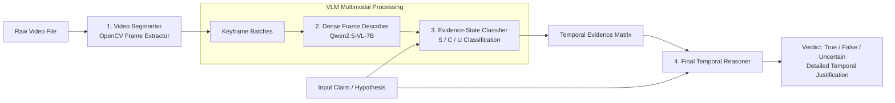

# Context Modelling for Video Reasoning (Spatio-Temporal Evidence-State Framework) 🎬🧠

[](https://www.python.org)
[](https://huggingface.co/Qwen/Qwen2.5-VL-7B-Instruct)
[](https://opencv.org)
[](https://openrouter.ai)
[](LICENSE)

An experimental AI research framework for **fine-grained video reasoning and claim verification** through **temporal segment decomposition**, **Vision-Language Model (VLM) frame description**, and **Evidence-State classification (Supported / Contradicted / Unobserved)**.

---

## 🎯 Research Motivation & Philosophy

Standard Video-LLMs struggle with long-horizon temporal claims because they compress video frames into sparse token bags, leading to hallucination and temporal disorientation. 

This framework solves this by introducing an explicit **Evidence-State Context Loop**:

1. **Temporal Segmentation**: Video is partitioned into consistent temporal windows (e.g. 3-second slices).
2. **Dense Multimodal Description**: Frames within each segment are analyzed via a Vision-Language Model (`Qwen2.5-VL-7B-Instruct`).
3. **Evidence-State Tagging**:
   - **`S` (Supported)**: The segment provides explicit positive evidence supporting the claim.
   - **`C` (Contradicted)**: The segment directly refutes or contradicts the claim.
   - **`U` (Unobserved)**: The claim entities or actions are absent or unobservable in this window.
4. **Structured Temporal Synthesis**: The sequence of evidence states forms a temporal reasoning chain passed to the final reasoning engine.

---

## 🔬 System Pipeline Architecture



---

## 📁 Repository Structure

```
videomodelling/
├── src/
│   ├── segmenter.py          # OpenCV video slice extractor & frame sampler
│   ├── describer.py          # Multimodal frame captioning via OpenRouter
│   ├── classifier.py         # Evidence-State evaluator (S / C / U)
│   └── reasoner.py           # Multi-step causal reasoning over timeline
├── experiments/              # Benchmark validation runs
│   ├── exp1_opening_door.json
│   ├── exp2_door_opens.json
│   ├── exp3_robot_attack.json
│   ├── exp4_robot_sparks.json
│   └── exp5_eating_soup.json
├── main.py                   # CLI interface and pipeline orchestrator
├── requirements.txt          # Python dependencies
├── .env.example              # API key template
├── .gitignore                # Ignore secrets and binary videos
└── README.md                 # Scientific documentation
```

---

## 🚀 Installation & Setup

### 1. Prerequisites
- Python 3.11+
- FFmpeg & OpenCV system libraries

### 2. Virtual Environment Setup
```bash
# Clone the repository
git clone https://github.com/swayam690/video-evidence-reasoning.git
cd video-evidence-reasoning

# Create virtual environment
python3 -m venv venv
source venv/bin/activate

# Install dependencies
pip install -r requirements.txt
```

### 3. API Key Configuration
```bash
cp .env.example .env
# Open .env and insert your OpenRouter API key:
# OPENROUTER_API_KEY=your_key_here
```

---

## 💻 Usage & CLI Interface

Execute the full reasoning pipeline on any video file:

```bash
python main.py \
  --video assets/robot_action.mp4 \
  --claim "The robot emits sparks before striking the door." \
  --segment-duration 3 \
  --output output.json
```

### CLI Arguments

| Parameter | Type | Default | Description |
| :--- | :--- | :--- | :--- |
| `--video` | `str` | *Required* | Path to input video file (`.mp4`, `.mov`, etc.) |
| `--claim` | `str` | *Required* | Hypothesis or claim to evaluate |
| `--segment-duration` | `int` | `3` | Granularity of temporal windows in seconds |
| `--output` | `str` | `output.json` | JSON output destination |

---

## 📊 Sample Execution Output

### Console Evidence Breakdown
```text
──────────────────────────────────────────────────────────────────
  CLAIM: "The robot emits sparks before striking the door."
──────────────────────────────────────────────────────────────────
  TIME WINDOW    STATE   OBSERVATION
──────────────────────────────────────────────────────────────────
  0.0s – 3.0s    U ❓    Robot powers on in dimly lit warehouse.
  3.0s – 6.0s    S ✅    Electrical arcs and bright sparks emanate from arm joint.
  6.0s – 9.0s    S ✅    Robot swings mechanical arm into metal vault door.
  9.0s – 12.0s   C ❌    Robot ceases movement; sparks have extinguished.
──────────────────────────────────────────────────────────────────
  FINAL VERDICT: SUPPORTED (Confidence: 0.94)
──────────────────────────────────────────────────────────────────
```

### JSON Results Export (`output.json`)
```json
{
  "claim": "The robot emits sparks before striking the door.",
  "segment_duration": 3,
  "temporal_evidence_context": [
    { "start": 0, "end": 3, "state": "U", "description": "Robot powers on in dimly lit warehouse." },
    { "start": 3, "end": 6, "state": "S", "description": "Electrical arcs and bright sparks emanate from arm joint." },
    { "start": 6, "end": 9, "state": "S", "description": "Robot swings mechanical arm into metal vault door." },
    { "start": 9, "end": 12, "state": "C", "description": "Robot ceases movement; sparks have extinguished." }
  ],
  "final_answer": {
    "verdict": "SUPPORTED",
    "temporal_logic": "Sparks verified at t=3-6s, preceding the physical impact observed at t=6-9s."
  }
}
```

---

## 🧪 Experiments & Benchmark Data

Pre-recorded experimental runs are provided in the root directory:
- `exp1_opening_door.json` — Temporal human interaction analysis
- `exp2_door_opens.json` — State transition verification
- `exp3_robot_attack.json` — Complex action-agent attribution
- `exp4_robot_sparks.json` — Fine-grained visual artifact detection
- `exp5_eating_soup.json` — Long-horizon procedural sequence validation

---

## 📄 License

This research code is open-sourced under the [MIT License](LICENSE).
